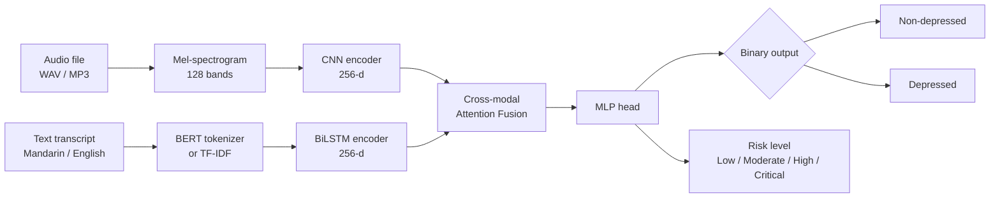

# Multimodal Depression Screening using EATD-Corpus

Bimodal (audio + text) depression detection with CNN, LSTM, and BiLSTM branches
and a late-fusion layer, trained on the EATD-Corpus — a Mandarin emotional-interview
dataset with SDS-derived binary labels.


> **Disclaimer — not a medical device.**  
> This system is a research prototype for depression *screening support* only.
> It is not validated for clinical use and must not replace professional diagnosis
> or treatment. All outputs must be interpreted by a qualified healthcare professional.

---

## Screenshots

> Add screenshots to `docs/screenshots/` after first run.
>
> Suggested: `dashboard.png`, `assessment.png`, `phq8.png`, `model_performance.png`

---

## Features

| Feature | Status |
|---------|--------|
| Bimodal assessment — text (required) + audio (optional) | Implemented |
| Heuristic fallback — runs without a model checkpoint | Implemented |
| PHQ-8 questionnaire — 8-item, severity band, agreement check | Implemented |
| Per-assessment report — risk level, confidence, modality contributions | Implemented |
| Model performance page — accuracy, F1, ROC-AUC, confusion matrix | Implemented |
| Crisis banner — shown for High / Critical risk | Implemented |
| Persistent crisis helpline footer (configurable) | Implemented |
| First-use consent modal | Implemented |
| Settings — delete all data | Implemented |

---

## System Architecture



Three branch experiments run independently before fusion:

| Branch | Encoder | Input |
|--------|---------|-------|
| CNN | 2D CNN | Mel-spectrogram |
| LSTM | Unidirectional LSTM | TF-IDF / BERT embeddings |
| BiLSTM | Bidirectional LSTM | BERT embeddings |
| Fusion | Cross-modal attention | audio (256-d) + text (256-d) |

---

## Dataset — EATD-Corpus

The **EATD-Corpus** (Shen et al., ICASSP 2022) contains Mandarin audio recordings
and text transcripts of responses to three emotional questions (positive, neutral,
negative) per participant. Labels derive from SDS (Self-Rating Depression Scale) scores.

| Property | Value |
|----------|-------|
| Participants | ~162 |
| Language | Mandarin Chinese |
| Modalities | Audio + text (no video) |
| Label source | SDS score ≥ 53 → depressed |
| Class split | ~78% non-depressed / ~22% depressed |

**Access:** Contact the authors via the paper or the
[GitHub release](https://github.com/speechandlanguageprocessing/ICASSP2022-Depression).
See [`docs/EATD_DATASET_GUIDE.md`](docs/EATD_DATASET_GUIDE.md) for the full
preprocessing workflow.

**The dataset is not included in this repository.**

---

## Models

```
Audio branch : mel-spectrogram → CNN → 256-d embedding
Text branch  : transcript → TF-IDF (fast) or BERT → BiLSTM → 256-d embedding
Fusion       : cross-modal attention → 512-d → MLP head
Task         : binary classification (depressed / non-depressed)
```

Detailed architecture: [`docs/PROJECT_SUMMARY.md`](docs/PROJECT_SUMMARY.md)

---

## Results

> **TO BE FILLED** — replace the table below with values from `ml/results/metrics.json`
> after completing training.

| Model | Accuracy | Precision | Recall | F1 | ROC-AUC |
|-------|----------|-----------|--------|----|---------|
| CNN (audio only) | — | — | — | — | — |
| LSTM (text only) | — | — | — | — | — |
| BiLSTM (text only) | — | — | — | — | — |
| Fusion (audio + text) | — | — | — | — | — |

Run training and populate `ml/results/metrics.json`. See
[`docs/HOW_TO_TRAIN.md`](docs/HOW_TO_TRAIN.md).

---

## Installation and Running

### Prerequisites

| Tool | Version |
|------|---------|
| Python | 3.9+ |
| Node.js | 18+ |
| npm | 9+ |

### Backend

```bash
cd backend
python -m venv venv
# Windows:    venv\Scripts\activate
# macOS/Linux: source venv/bin/activate
pip install -r requirements.txt
cp ../.env.example .env        # edit helpline number or ports if needed
python main.py
# API:  http://localhost:8000
# Docs: http://localhost:8000/docs
```

### Frontend (React)

```bash
cd frontend
npm install
npm start
# http://localhost:3000
```

### Streamlit demo

```bash
cd streamlit-app
pip install streamlit plotly requests
streamlit run Home.py
# http://localhost:8501
```

### Tests

```bash
cd backend
python -m pytest tests/ -v
```

Full guide: [`docs/HOW_TO_RUN.md`](docs/HOW_TO_RUN.md)

---

## API Overview

| Method | Endpoint | Description |
|--------|----------|-------------|
| GET | `/health` | Health check |
| GET | `/api/config/helpline` | Crisis helpline config |
| POST | `/api/assess/multimodal` | **Primary** bimodal assessment (text + optional audio) |
| GET | `/api/assessments/{user_id}` | Assessment history |
| DELETE | `/api/users/{user_id}/data` | Delete all user data |
| POST | `/api/phq8/score` | Score PHQ-8 (8 answers, 0–3 each) |
| GET | `/api/phq8/history/{user_id}` | PHQ-8 history |
| GET | `/api/model/metrics` | Model performance metrics |
| POST | `/api/journal/entry` | Create journal entry |
| GET | `/api/journal/entries/{user_id}` | Journal entries |
| POST | `/api/chat` | Mental health chatbot |
| POST | `/api/users/register` | Register user profile |
| POST | `/api/multimodal/analyze` | Alias for `/api/assess/multimodal` |
| POST | `/api/multimodal/analyze/text` | Text-only JSON shortcut |

---

## Project Structure

```
multimodal_mental_health_analysis/
├── .env.example                 # environment variable template
├── .gitignore                   # blocks datasets, audio, weights, secrets
├── LICENSE
├── README.md
├── run_pipeline.py              # one-command training pipeline
│
├── backend/
│   ├── main.py                  # FastAPI app (all endpoints)
│   ├── app_config.py            # helpline number, file limits
│   ├── config.py                # dataset mode, hyperparameters
│   ├── multimodal_model.py      # BERT + CNN + BiLSTM model
│   ├── models_ml.py             # branch architectures (AudioCNN, TextLSTM, TextBiLSTM)
│   ├── dataset.py               # EATDDataset (PyTorch)
│   ├── eatd_adapter.py          # EATD-Corpus → processed format
│   ├── train.py                 # full BERT training script
│   ├── train_cpu_fast.py        # CPU-friendly TF-IDF training
│   ├── model_metrics.json       # ⚠ placeholder — update after training
│   ├── tests/
│   │   ├── test_phq8.py
│   │   └── test_multimodal.py
│   ├── checkpoints/             # .pt files (ignored by git)
│   └── requirements.txt
│
├── frontend/
│   ├── src/
│   │   ├── App.js               # routes + MUI theme
│   │   ├── components/
│   │   │   ├── Navigation.js    # collapsible sidebar
│   │   │   ├── CrisisFooter.js  # persistent helpline footer
│   │   │   ├── CrisisBanner.js  # high-risk alert banner
│   │   │   └── ConsentModal.js  # first-use consent dialog
│   │   ├── pages/
│   │   │   ├── Dashboard.js     # KPI overview + assessment history
│   │   │   ├── Assessment.js    # bimodal input (text + audio recorder)
│   │   │   ├── ReportDetail.js  # per-assessment explainability
│   │   │   ├── PHQ8.js          # PHQ-8 questionnaire
│   │   │   ├── ModelPerformance.js  # metrics table + confusion matrix
│   │   │   └── Settings.js      # privacy + delete data
│   │   └── services/api.js      # Axios API client
│   └── package.json
│
├── streamlit-app/
│   ├── Home.py                  # overview dashboard
│   └── pages/
│       ├── 1_Assessment.py
│       ├── 2_PHQ8.py
│       └── 6_Bimodal_Analysis.py
│
├── ml/
│   └── results/
│       └── metrics.json         # ⚠ placeholder — replace after training
│
└── docs/
    ├── HOW_TO_RUN.md
    ├── HOW_TO_TRAIN.md
    ├── DEPLOYMENT.md
    ├── EATD_DATASET_GUIDE.md
    └── PROJECT_SUMMARY.md
```

---

## Ethics, Privacy, and Disclaimer

- **Not a diagnostic tool.** Outputs are probabilistic indicators, not diagnoses.
- **No data leaves the browser or local server** unless you deploy to a remote host.
- Uploaded audio is deleted after feature extraction.
- A first-use consent dialog explains what is processed and stored.
- The Settings page provides a hard-delete option for all stored data.
- All pages display the crisis helpline and the screening-support disclaimer.

---

## Limitations

1. **Small dataset** — EATD-Corpus has ~162 participants; models may not generalise well.
2. **Mandarin-only audio and text** — results on other languages are unknown.
3. **Class imbalance** — ~78% non-depressed; minority-class recall is a known challenge.
4. **No clinical validation** — the system has not been tested in a clinical population.
5. **No video modality** — EATD-Corpus contains no video; facial cues are absent.
6. **Heuristic fallback** — when no checkpoint is loaded, the API uses a rule-based
   linguistic analyser; accuracy is lower than a trained model.

---

## Future Work

- Video modality (facial action units) using a dataset that provides video recordings.
- Cross-lingual models to support non-Mandarin speakers.
- Larger or multi-corpus training (combine EATD with other publicly available corpora).
- Clinical validation study with psychiatrists.
- Longitudinal tracking across multiple sessions.

---

## Author and Acknowledgements

| Field | Value |
|-------|-------|
| Author | [YOUR NAME] |
| Institution | [COLLEGE / UNIVERSITY] |
| Department | [DEPARTMENT] |
| Guide / Supervisor | [GUIDE NAME] |
| Academic Year | [YEAR] |

---

## Citation

If you use the EATD-Corpus, please cite:

```bibtex
@inproceedings{shen2022automatic,
  title     = {Automatic Depression Detection: An Emotional Audio-Textual Corpus
               and a {GRU}/{BiLSTM}-Based Model},
  author    = {Shen, Yiheng and Yang, Hebin and Lin, Linlin},
  booktitle = {ICASSP 2022 -- IEEE International Conference on Acoustics,
               Speech and Signal Processing},
  pages     = {6247--6251},
  year      = {2022},
  doi       = {10.1109/ICASSP43922.2022.9747870}
}
```

---

## License

This project is licensed under the MIT License — see [`LICENSE`](LICENSE).  
The EATD-Corpus is separately licensed for academic research only; see
[`docs/EATD_DATASET_GUIDE.md`](docs/EATD_DATASET_GUIDE.md).
